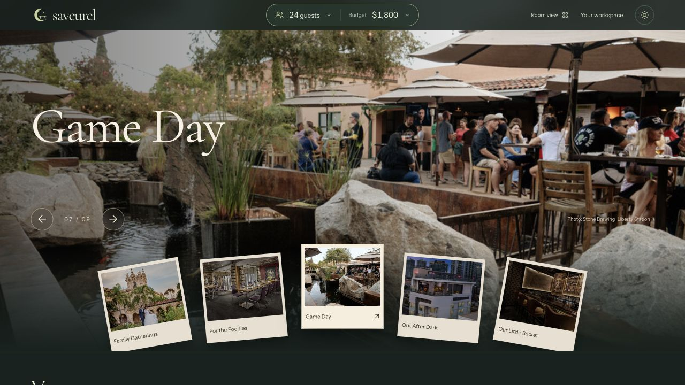
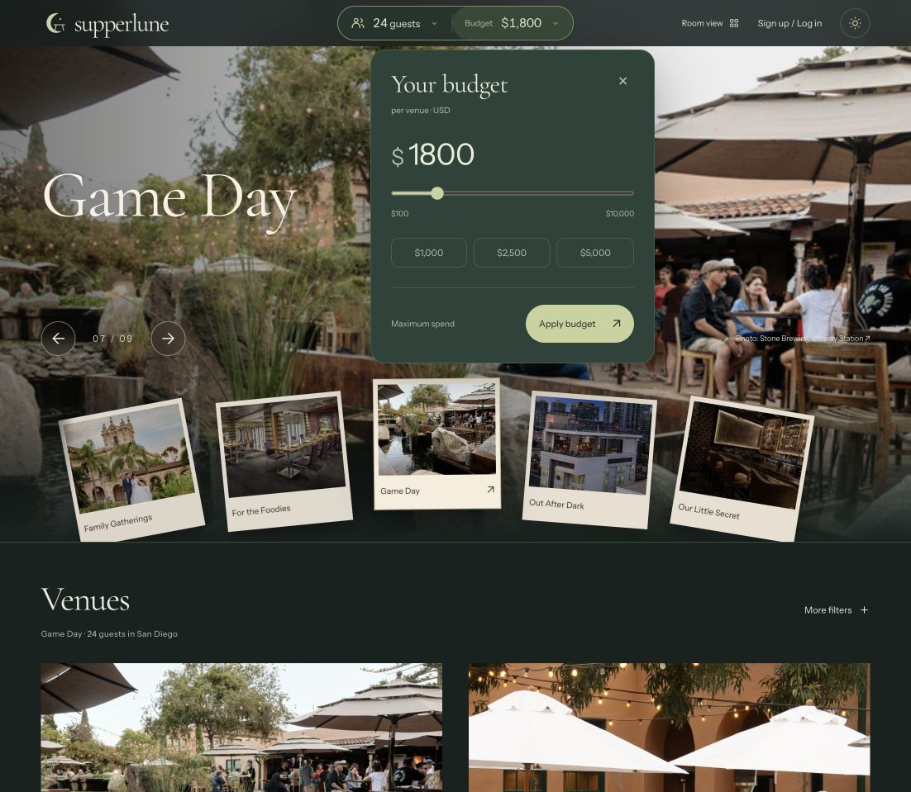
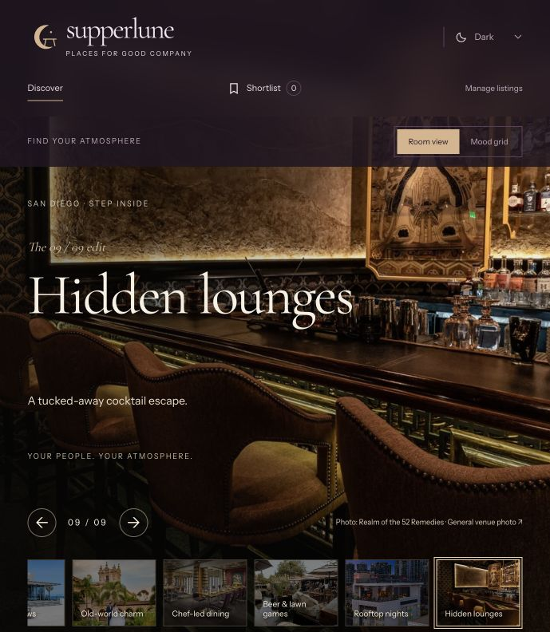

# Saveurel: choosing a gathering by people, mood and budget

Saveurel is an early venue-discovery prototype for small gatherings in San Diego. It was built through collaboration between Dai Yu and Codex beginning October 20, 2026. Earlier iterations used the names Gatherlist and Supperlune; the repository keeps its original identifier.

This is the current source running locally, not a claim of a public live deployment.

## The customer problem

An organizer usually starts with a group size, an occasion and a budget. Saveurel turns those choices into visual room moods, source-linked venue candidates and a shortlist of questions to confirm with the venue.

## What to review

- Guest presets: 2, 4, 6, 8, 10, 12 and 24+, with exact adjustment.
- Nine visual moods: Date Night, Garden Party, Something Different, Sunset Toasts, Family Gatherings, For the Foodies, Game Day, Out After Dark and Our Little Secret.
- An immersive manual carousel that changes room imagery and palette. Normal mouse-wheel scrolling moves down the page.
- Eighteen different featured venues, two per mood. Source links and unknown costs stay visible.
- Browser-local shortlists, CSV import/export and a Markdown brief.
- Server-authorized signup records, plus an independent Node/SQLite private-preview deployment prepared for Oracle.

The two iteration screenshots above show earlier branding. Current source uses Saveurel. Venue photography remains third-party material and is not covered by a code license.

## Human direction and Codex contribution

Dai chose the market and initial city, prioritized guest count, mood and budget, and directed repeated interface changes: fewer words, a thinner header, nine distinct moods, no repeated featured venues and no scroll-wheel room switching. Codex researched venue sources, implemented the interface, matching and exports, added account storage, and wrote and ran checks. This is a documented collaboration, not a claim of autonomous operation or customer traction.

See the [build record](build-record.md), [source notes](sources.md), [application logic](../public/core.js) and [account tests](../tests/accounts.test.mjs). The extractor and matcher use local rules; they do not call a model.

## Verification and limits

The project has 30 application checks and six separate Oracle deployment checks, including real local SQLite persistence and an HTTP server restart. Development sign-in uses a test identity. A complete live sign-in round trip and remote Oracle deployment remain unverified. ARM and AMD free-tier launch attempts both failed because San Jose had no free capacity; the app is not Oracle-hosted.

The hosted preview remains private. The public source and screenshots provide reviewer access without exposing member records or server credentials. Shortlists stay in the browser and do not sync through the signup database.

There are no established customers, bookings, revenue, downloads or independent usage figures. Prices and availability require confirmation with the venue. Saveurel is a working name; trademark clearance has not been completed.

## Next useful contributions

Make the discovery starter easy to adapt to another city, improve accessibility, add source-validation tooling, and document recurring maintenance workflows. These are proposed improvements, not existing features or promised program commitments.

## Builder introduction

[Dai Yu’s 24-second Codex Ambassador introduction](dai-yu-codex-introduction.mp4). This is an applicant introduction, not a platform demonstration or evidence of program acceptance.
